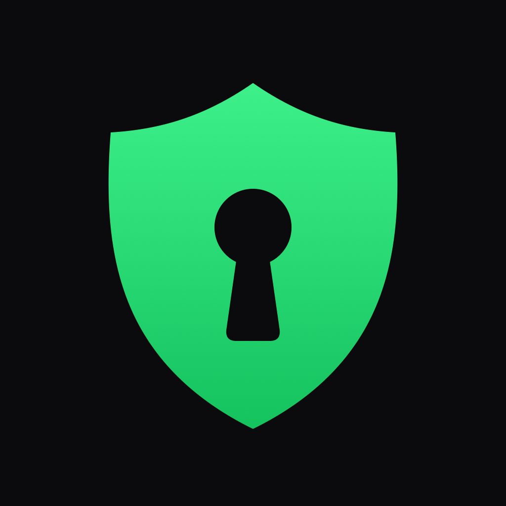
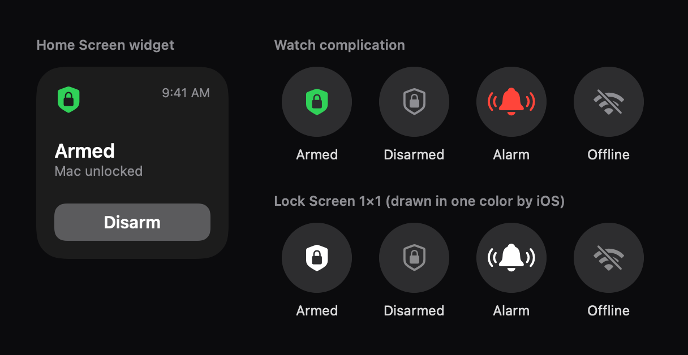

<div align="center">
  
  <h1>MacGuard</h1>
  <p>A menu bar app that locks your MacBook the moment someone touches it while you are away, and alerts your iPhone and Apple Watch</p>
</div>

English · [한국어](README.ko.md)

<p align="center">
  
  <br>
  <sub>How the widgets and complications look in each state. Redrawn with the same icon and colors as the app (<code>scripts/make-readme-images.swift</code>).</sub>
</p>

When you leave your MacBook on and step away, turn on guard mode. The moment someone touches the keyboard or trackpad, the password screen comes up.
If you do not unlock within a set time, it sends a notification to your iPhone. It does not sleep or shut down the Mac (the lock is the same as ⌃⌘Q),
so terminal agents, builds, and downloads keep running.

> [!NOTE]
> This is a personal project with no distributable build (no dmg, not on the App Store), so you build it yourself. You need an Apple developer account, Xcode, and Tailscale.
> The app's on-screen text is in English; code comments and the linked documents are in Korean.

## What it does

- **Lock on touch**: While guard mode is on, it locks right away when it detects human keyboard or trackpad input, or a wake from sleep. Synthetic input, such as AI computer-use, is filtered out.
- **One alert**: If the Mac is not unlocked within the alarm delay after locking (default 10 seconds), it sends one notification with sound to the iPhone. If the iPhone is locked, iOS forwards it to the Apple Watch, which also alerts.
- **Unlock yourself and it ends**: Unlocking with Touch ID or a password turns off guard mode and the alarm. A "MacBook unlocked" notification arrives only if the unlock happens after the alarm has already sounded.
- **Remote control**: From the watch, iPhone, or widgets: turn guard mode on or off, stop the alarm, lock now.
- **Screen view** (optional): While you are away, receive the Mac screen on the watch or iPhone. Tap the image to magnify that spot 3x.
- **Status at a glance**: iPhone home screen widget (with buttons), Lock Screen 1x1 widget, watch face complication.
- **Lightweight**: While guard mode is off, it does not watch input (measurements are in the [verification log](docs/VERIFICATION.md#부하-2026-10-22) (Korean)).

## How it works

```
Turn on guard mode (watch, iPhone, widget, Mac menu)
 └ Human input or wake detected → lock immediately (password screen)
     ├ You unlock within the delay → guard mode turns off, no notification
     └ Not unlocked → one iPhone notification (the watch also alerts if the iPhone is locked)
         └ Ends on any of: "Stop Alarm" (no new alarm for 5 minutes) · Mac unlocked · 10 minutes elapsed
```

The Mac app opens an HTTP API that listens only on `127.0.0.1`. The watch and iPhone call this API through the public HTTPS address that Tailscale Funnel provides,
and every request needs an access token. The Mac app sends notifications directly through APNs (there is no separate server).

**Telling human input apart**

- Unlocked screen: Only input whose sending-process PID is 0 at the HID-level event tap counts as human input. Synthetic input such as AI computer-use carries the sending process's PID.
  Each ignored synthetic input is logged once per process as `synthetic-ignored`.
- Locked screen: Secure input in the password field can hide keystrokes from the tap, so it falls back on the time since the last input (HIDIdleTime) returning to 0.
- Approaches not used: watching HIDIdleTime alone (it also returns to 0 on synthetic input, which caused false alarms during AI work), and IOHIDManager (it cannot see built-in trackpad movement).

## Requirements

- A Mac with macOS 14 or later, an iPhone with iOS 17 or later, an Apple Watch with watchOS 10 or later
- Xcode, [XcodeGen](https://github.com/yonaskolb/XcodeGen)
- Apple developer account (paid): needed to install on devices and for push notifications (APNs key)
- [Tailscale](https://tailscale.com) Funnel: the path that lets a watch or iPhone away from home reach the Mac

## Installation

### 1. Replace the values with your own

The team ID and bundle IDs are the author's values (`Y35NBHS9WU`, `com.jinwoo.*`). Find where they appear with the command below and replace them with your own.

```sh
git grep -n -e Y35NBHS9WU -e com.jinwoo
```

They are in `watch/project.yml` (team ID, bundle IDs), `watch/Support/Info.plist`, `scripts/` (Mac app bundle ID, login item name, APNs settings),
and `Sources/GuardCore/Config.swift` (default bundle ID of the iPhone app).

### 2. Mac app

```sh
scripts/build-app.sh      # build dist/MacGuard.app, signed with an Apple Development certificate
scripts/install.sh        # install to /Applications + register the login item, create the access token and default settings
```

The first time you launch it, a prompt asks you to allow Input Monitoring. Once you allow it, monitoring attaches within 2 seconds without relaunching the app.
The permission is tied to the signing identity, so sign with a development certificate (ad-hoc signing with `codesign -s -` loses the permission on every build).
If the app is relaunched with "Quit & Reopen", it runs outside the login item, so run `scripts/install.sh` once more.

### 3. External access

```sh
tailscale funnel --bg 8787   # the first time, approve the Funnel link for your tailnet
```

The address becomes `https://<Mac name>.<tailnet>.ts.net`. To turn it off, run `tailscale funnel reset`.

### 4. Push notifications

Get an APNs key from Apple Developer, place it at `~/.config/mac_guard/AuthKey_<KeyID>.p8`, and run:

```sh
scripts/configure-push.sh    # reads the Key ID from the file name, fills in the settings, and relaunches the app (sandbox by default; the key contents are not read)
```

### 5. iPhone and watch apps

```sh
scripts/make-watch-secrets.sh https://<Mac name>.<tailnet>.ts.net   # generate the file that puts the address and token into the apps (excluded from git)
cd watch && xcodegen generate && open MacGuardWatch.xcodeproj       # install on the iPhone with the MacGuardPhone scheme
```

The watch app is bundled inside the iPhone app. Install it from the iPhone's Watch app, under available apps (installing directly from the Mac to the watch often fails with a Bluetooth timeout).
For an already installed watch app, raise the build number (`CURRENT_PROJECT_VERSION`) so the iPhone passes the update to the watch; the handoff can take more than 10 minutes.

## Usage

- **Mac menu bar**: Arm, Disarm, Lock Now, Stop Alarm, View Screen Without Arming. If a permission is missing, "Allow Input Monitoring…" and "Allow Screen Recording…" appear.
- **iPhone app**: One large status and buttons (turn guard mode on or off or stop the alarm, view screen, lock now). In Settings you change the alarm delay, the grace period before monitoring starts, and lock on touch.
- **Watch app**: Stop alarm, turn guard mode on or off, lock now, view screen.
- **Widgets**: The home screen widget shows the status and one button. The Lock Screen 1x1 widget and the watch complication show only a status icon, and tapping opens the app.
  The Lock Screen is drawn by the system in a single color, so the states are told apart by shape (filled shield = guard mode on, empty shield = off, bell = alarm, broken Wi-Fi = cannot reach the Mac).

Turning on guard mode does not lock the Mac, so if you move the mouse yourself right after turning it on, it still locks. If you need time after turning it on, use `armGraceSeconds`.

## Settings

`~/.config/mac_guard/config.json`. Missing entries use the defaults.

| Key | Default | Meaning |
| --- | --- | --- |
| `port` | `8787` | API port (127.0.0.1) |
| `lockOnTouch` | `true` | Lock on touch. If off, it only notifies and does not lock |
| `lockOnArm` | `false` | Lock the moment guard mode is turned on |
| `armGraceSeconds` | `0` | Time after turning on guard mode during which input is ignored (0-30 seconds) |
| `alarmDelaySeconds` | `10` | Time to wait after locking before notifying (0-60 seconds) |
| `alarmMaxSeconds` | `600` | Time after which the alarm state ends by itself |
| `alarmSnoozeSeconds` | `300` | Time after "Stop Alarm" during which new alarms are blocked |
| `screenView` | `false` | Allow screen view (captures only while guard mode is on, the Mac is unlocked, and the display is on) |
| `screenViewWhenDisarmed` | `false` | Screen view without guard mode. Can only be turned on from the Mac menu |
| `apns` | none | Filled in by `scripts/configure-push.sh` |

## Security and privacy

- The API listens only on `127.0.0.1`, and every request needs `Authorization: Bearer <token>`. With a wrong token it returns 401 without even revealing whether the path exists.
- The token is in `~/.config/mac_guard/api_token` (0600) and is also built into the watch and iPhone apps. Do not give the apps you build to anyone else.
- With Funnel on, internet scanner requests reach the public address (at most 27 per minute when measured, all 401).
- With screen view on, screen pixels go out to the public address. The only protection is the token. The image is created in memory only and is never saved to a file.
- The app changes only the lock screen and its own files (`~/.config/mac_guard`, `~/Library/Logs/MacGuard`). It neither reads nor changes the power, sleep, or screen saver settings.

For details see [PRIVACY.md](PRIVACY.md) (Korean); to report a vulnerability see [SECURITY.md](SECURITY.md) (Korean).

## Known limitations

- It cannot fully block an attack that keeps flooding it with connections (16 concurrent connections; a slow connection holds a slot for up to about 6 seconds).
- Input detection on the locked screen (the idle-time fallback) has not been sufficiently verified on a real device.
- While you are using the iPhone, the notification appears only on the iPhone and the watch does not alert (default iOS behavior).
- The public Funnel path has dropped before (cause not determined). When it drops, the notification still arrives, but "Stop Alarm", screen view, and device registration do not work.
- An app run in the simulator does not send its push token to the Mac (the Mac remembers only one token per device, so it would overwrite the real device's registration).

The full verification and measurement records are in [docs/VERIFICATION.md](docs/VERIFICATION.md) (Korean).

## API

`127.0.0.1` only, with `Authorization: Bearer <token>`.

| Request | What it does |
| --- | --- |
| `GET /v1/status` | Status |
| `POST /v1/arm {"lockOnTouch"?}` · `POST /v1/disarm` | Turn guard mode on or off |
| `POST /v1/lock` · `POST /v1/ack` | Lock now · stop the alarm |
| `POST /v1/settings {"lockOnTouch"?, "alarmDelaySeconds"?, "armGraceSeconds"?, "screenViewWhenDisarmed"?}` | Change settings. Only the changed entries are saved; out-of-range values return 400. `screenViewWhenDisarmed` can only be turned off (turning it on returns 403 `enable-on-mac`) |
| `POST /v1/watch-token` · `POST /v1/phone-token {"token", "environment"?}` | Register a push token |
| `POST /v1/screen {"width"?, "region"?}` | One screen image (`image/jpeg`). Refusals are 403, 409, 429, or 503 with the code `disabled`, `disarmed`, `locked`, `display-asleep`, `permission`, `too-soon`, or `capture-failed` |

## Development

| Part | Location |
| --- | --- |
| Mac app | `Sources/MacGuard` — menu bar, input detection, locking, HTTP server, screen capture |
| Core logic | `Sources/GuardCore` — guard decisions (`GuardEngine`), HTTP parser and API, APNs, settings |
| iPhone and watch | `watch/` (XcodeGen) — `Phone` iPhone app, `App` watch app, `Widget` iPhone widget, `WatchWidget` complication |
| Tests | `Tests/GuardCoreTests` — `swift test` |

`RUNS.md` is a log of the agent work done on each task (review method and time taken).

## Uninstall

```sh
scripts/install.sh --uninstall   # removes only the login item (keeps the app, settings, and logs)
tailscale funnel reset           # turn off external access
```

To remove everything, also delete `/Applications/MacGuard.app`, `~/.config/mac_guard`, and `~/Library/Logs/MacGuard`.

## Feedback

I am new to this field and there is a lot I still get wrong. If you see something to fix or something I should know, an issue or PR would be very much appreciated.

## License

MIT — [LICENSE](LICENSE)
