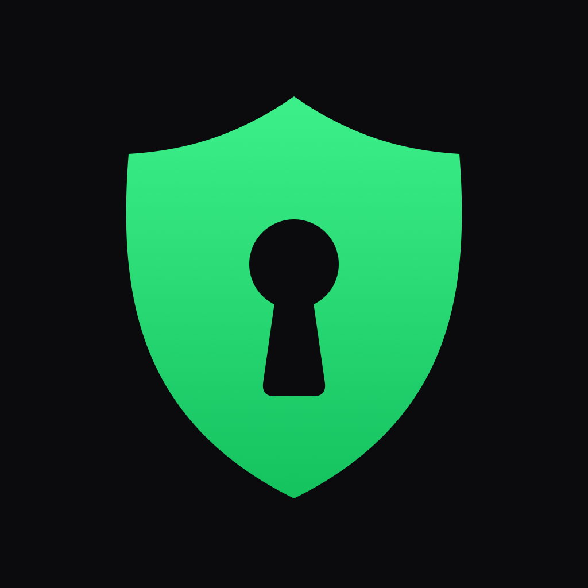
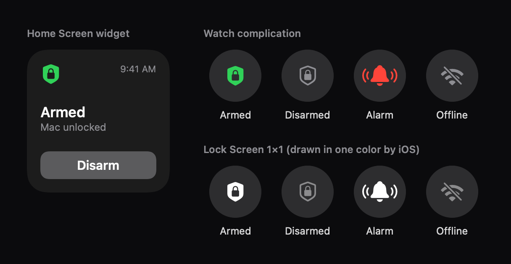

<div align="center">
  
  <h1>MacGuard</h1>
  <p>자리 비운 맥북을 누가 만지면 바로 잠그고 아이폰·애플워치로 알려 주는 메뉴 막대 앱</p>
</div>

<p align="center">
  
  <br>
  <sub>위젯·컴플리케이션 상태별 모양. 앱과 같은 아이콘·색으로 다시 그린 그림이다(<code>scripts/make-readme-images.swift</code>).</sub>
</p>

맥북을 켜 둔 채 자리를 비울 때 경계를 켜 두면, 누가 키보드·트랙패드를 만지는 순간 비밀번호 화면을 띄운다.
정해 둔 시간 안에 본인이 풀지 않으면 아이폰으로 알림을 보낸다. 맥을 재우거나 끄지 않으므로(⌃⌘Q와 같은 잠금)
터미널 에이전트·빌드·다운로드는 계속 돈다.

> [!NOTE]
> 배포 파일(dmg·App Store)이 없는 개인 프로젝트라 직접 빌드해서 쓴다. Apple 개발자 계정, Xcode, Tailscale이 필요하다.
> 앱 화면 글자는 영어, 이 문서와 코드 주석은 한국어다.

## 하는 일

- **만지면 잠금**: 경계 중 사람의 키보드·트랙패드 입력이나 잠자기에서 깨어남을 감지하면 바로 잠근다. AI 화면 조작(computer-use) 같은 합성 입력은 거른다.
- **알림 한 번**: 잠긴 뒤 알람 대기 시간(기본 10초) 안에 풀리지 않으면 아이폰에 소리 있는 알림을 한 번 보낸다. 아이폰이 잠겨 있으면 iOS가 애플워치로 넘겨 워치도 울린다.
- **본인이 풀면 끝**: Touch ID·비밀번호로 풀면 경계와 알람이 꺼진다. 알람이 이미 울린 뒤에 풀렸을 때만 "MacBook unlocked" 알림이 온다.
- **원격 조작**: 워치·아이폰·위젯에서 경계 켜기·끄기, 알람 끄기, 지금 잠그기.
- **화면 보기**(선택): 자리를 비운 동안 워치·아이폰으로 맥 화면을 받아 본다. 그림을 누르면 그 자리를 3배로 확대한다.
- **한눈에 상태**: 아이폰 홈 화면 위젯(버튼 포함), 잠금 화면 1x1 위젯, 워치 페이스 컴플리케이션.
- **가벼움**: 경계가 꺼져 있으면 입력을 감시하지 않는다(측정값은 [검증 기록](docs/VERIFICATION.md#부하-2026-10-22)).

## 동작 방식

```
경계 켜기 (워치·아이폰·위젯·맥 메뉴)
 └ 사람 입력이나 깨어남 감지 → 바로 잠금(비밀번호 화면)
     ├ 대기 시간 안에 본인이 풀면 → 경계 꺼짐, 알림 없음
     └ 풀리지 않으면 → 아이폰 알림 한 번 (아이폰이 잠겨 있으면 워치도 울림)
         └ "Stop Alarm"(5분간 새 알람 없음) · 맥 잠금 해제 · 10분 경과 중 하나로 끝
```

맥 앱은 `127.0.0.1`에서만 듣는 HTTP API를 연다. 워치·아이폰은 Tailscale Funnel이 넘겨주는 공개 HTTPS 주소로 이 API를 부르고,
모든 요청에 접속 토큰이 필요하다. 알림은 맥 앱이 APNs로 직접 보낸다(별도 서버 없음).

**사람 입력 가려내기**

- 풀린 화면: HID 단계 이벤트 탭에서 보낸 프로세스 PID가 0인 입력만 사람 입력으로 본다. AI 화면 조작 같은 합성 입력에는 보낸 프로세스 PID가 찍힌다.
  무시한 합성 입력은 프로세스마다 한 번 `synthetic-ignored`로 기록한다.
- 잠긴 화면: 비밀번호 칸의 보안 입력 때문에 키 입력이 탭에 안 보일 수 있어, 마지막 입력 뒤 경과 시간(HIDIdleTime)이 0으로 돌아가는 것으로 보조한다.
- 쓰지 않는 방식: HIDIdleTime만 보기(합성 입력에도 0으로 돌아가 AI 작업 중 잘못 울림), IOHIDManager(내장 트랙패드 움직임을 못 봄).

## 요구 사항

- macOS 14 이상 맥, iOS 17 이상 아이폰, watchOS 10 이상 애플워치
- Xcode, [XcodeGen](https://github.com/yonaskolb/XcodeGen)
- Apple 개발자 계정(유료): 기기 설치와 푸시 알림(APNs 키)에 필요
- [Tailscale](https://tailscale.com) Funnel: 밖에 있는 워치·아이폰이 맥에 닿는 경로

## 설치

### 1. 내 값으로 바꾸기

팀 ID와 번들 ID가 만든 사람 값(`Y35NBHS9WU`, `com.jinwoo.*`)으로 들어 있다. 아래 명령으로 위치를 찾아 본인 값으로 바꾼다.

```sh
git grep -n -e Y35NBHS9WU -e com.jinwoo
```

`watch/project.yml`(팀 ID·번들 ID), `watch/Support/Info.plist`, `scripts/`(맥 앱 번들 ID·로그인 항목 이름·APNs 설정),
`Sources/GuardCore/Config.swift`(아이폰 앱 기본 번들 ID)에 있다.

### 2. 맥 앱

```sh
scripts/build-app.sh      # dist/MacGuard.app 빌드, Apple Development 인증서로 서명
scripts/install.sh        # /Applications 설치 + 로그인 항목 등록, 접속 토큰·기본 설정 생성
```

처음 켤 때 입력 모니터링 허용 창이 뜬다. 허용하면 앱을 다시 켜지 않아도 2초 안에 감시가 붙는다.
허용은 서명 신원에 묶이므로 개발 인증서로 서명한다(임시 서명 `codesign -s -`은 빌드할 때마다 허용이 풀린다).
"종료 후 다시 열기"로 다시 켜지면 로그인 항목 밖에서 돌게 되니 `scripts/install.sh`를 한 번 더 실행한다.

### 3. 외부 연결

```sh
tailscale funnel --bg 8787   # 처음엔 tailnet에서 Funnel 허용 링크를 승인해야 한다
```

주소는 `https://<맥 이름>.<tailnet>.ts.net`이 된다. 끌 때는 `tailscale funnel reset`.

### 4. 푸시 알림

Apple Developer에서 APNs 키를 받아 `~/.config/mac_guard/AuthKey_<KeyID>.p8`로 두고 실행한다.

```sh
scripts/configure-push.sh    # 파일 이름에서 Key ID를 읽어 설정을 채우고 앱을 다시 켠다(기본 sandbox, 키 내용은 읽지 않음)
```

### 5. 아이폰·워치 앱

```sh
scripts/make-watch-secrets.sh https://<맥 이름>.<tailnet>.ts.net   # 주소·토큰을 앱에 넣는 파일 생성(git 제외)
cd watch && xcodegen generate && open MacGuardWatch.xcodeproj       # MacGuardPhone 스킴으로 아이폰에 설치
```

워치 앱은 아이폰 앱에 들어 있다. 아이폰 Watch 앱 → 사용 가능한 앱에서 설치한다(맥에서 워치로 직접 설치는 블루투스 시간 초과로 자주 실패한다).
이미 설치된 워치 앱은 빌드 번호(`CURRENT_PROJECT_VERSION`)를 올려야 아이폰이 워치로 넘기고, 넘어가는 데 10분 넘게 걸릴 수 있다.

## 사용법

- **맥 메뉴 막대**: Arm·Disarm, Lock Now, Stop Alarm, View Screen Without Arming. 권한이 빠졌으면 "Allow Input Monitoring…", "Allow Screen Recording…"이 뜬다.
- **아이폰 앱**: 큰 상태 하나와 버튼(경계 켜기·끄기 또는 알람 끄기, 화면 보기, 지금 잠그기). Settings에서 알람 대기 시간, 감시 시작 유예, 만지면 잠금을 바꾼다.
- **워치 앱**: 알람 끄기, 경계 켜기·끄기, 지금 잠그기, 화면 보기.
- **위젯**: 홈 화면 위젯은 상태와 버튼 하나. 잠금 화면 1x1 위젯과 워치 컴플리케이션은 상태 아이콘만 보여 주고, 누르면 앱이 열린다.
  잠금 화면은 시스템이 한 가지 색으로 그려서 모양으로 구분한다(채운 방패 = 경계 중, 빈 방패 = 꺼짐, 종 = 알람, 끊긴 와이파이 = 맥에 닿지 않음).

경계를 켜도 맥은 잠그지 않으므로, 켠 뒤 본인이 마우스를 움직여도 잠긴다. 켜고 나서 여유가 필요하면 `armGraceSeconds`를 쓴다.

## 설정

`~/.config/mac_guard/config.json`. 빠진 항목은 기본값을 쓴다.

| 항목 | 기본 | 뜻 |
| --- | --- | --- |
| `port` | `8787` | API 포트(127.0.0.1) |
| `lockOnTouch` | `true` | 만지면 잠금. 끄면 잠그지 않고 알림만 |
| `lockOnArm` | `false` | 경계를 켜는 순간 잠금 |
| `armGraceSeconds` | `0` | 경계를 켠 뒤 입력을 무시하는 시간(0~30초) |
| `alarmDelaySeconds` | `10` | 잠긴 뒤 알림까지 기다리는 시간(0~60초) |
| `alarmMaxSeconds` | `600` | 알람 상태가 저절로 끝나는 시간 |
| `alarmSnoozeSeconds` | `300` | "Stop Alarm" 뒤 새 알람을 막는 시간 |
| `screenView` | `false` | 화면 보기 허용(경계 중이면서 맥이 풀려 있고 화면이 켜져 있을 때만 찍음) |
| `screenViewWhenDisarmed` | `false` | 경계 없이도 화면 보기. 맥 메뉴에서만 켤 수 있다 |
| `apns` | 없음 | `scripts/configure-push.sh`가 채운다 |

## 보안과 개인정보

- API는 `127.0.0.1`에서만 듣고 모든 요청에 `Authorization: Bearer <토큰>`이 필요하다. 토큰이 틀리면 경로가 있는지도 알려 주지 않고 401을 준다.
- 토큰은 `~/.config/mac_guard/api_token`(0600)에 있고 워치·아이폰 앱 빌드에도 들어간다. 빌드한 앱을 남에게 주지 않는다.
- Funnel을 켜면 공개 주소에 인터넷 스캐너 요청이 들어온다(측정 때 많으면 1분에 27건, 모두 401).
- 화면 보기를 켜면 화면 픽셀이 공개 주소로 나간다. 막는 것은 토큰 하나뿐이다. 그림은 메모리에서만 만들고 파일로 남기지 않는다.
- 앱이 바꾸는 것은 잠금 화면과 자기 파일(`~/.config/mac_guard`, `~/Library/Logs/MacGuard`)뿐이다. 전원·잠자기·화면 보호기 설정은 읽지도 바꾸지도 않는다.

자세한 내용은 [PRIVACY.md](PRIVACY.md), 취약점 제보는 [SECURITY.md](SECURITY.md).

## 알려진 한계

- 연결을 계속 퍼붓는 공격은 완전히 막지 못한다(동시 연결 16개, 느린 연결은 최대 약 6초 자리를 잡는다).
- 잠긴 화면에서의 입력 감지(유휴 시간 보조)는 실기로 충분히 확인하지 못했다.
- 아이폰을 쓰고 있을 때는 아이폰에만 알림이 뜨고 워치는 울리지 않는다(iOS 기본 동작).
- Funnel 공개 경로가 끊긴 적이 있다(원인 미확정). 끊겨도 알림은 가지만 "Stop Alarm"·화면 보기·기기 등록은 안 된다.
- 시뮬레이터에서 돌린 앱은 푸시 토큰을 맥에 보내지 않는다(맥은 기기마다 토큰 하나만 기억해 실제 기기 등록을 덮어쓰기 때문).

확인·측정 기록 전체는 [docs/VERIFICATION.md](docs/VERIFICATION.md).

## API

`127.0.0.1`만, `Authorization: Bearer <토큰>`.

| 요청 | 하는 일 |
| --- | --- |
| `GET /v1/status` | 상태 |
| `POST /v1/arm {"lockOnTouch"?}` · `POST /v1/disarm` | 경계 켜기·끄기 |
| `POST /v1/lock` · `POST /v1/ack` | 지금 잠그기 · 알람 끄기 |
| `POST /v1/settings {"lockOnTouch"?, "alarmDelaySeconds"?, "armGraceSeconds"?, "screenViewWhenDisarmed"?}` | 설정 바꾸기. 바꾼 항목만 저장, 범위 밖은 400. `screenViewWhenDisarmed`는 끄기만 된다(켜기는 403 `enable-on-mac`) |
| `POST /v1/watch-token` · `POST /v1/phone-token {"token", "environment"?}` | 푸시 토큰 등록 |
| `POST /v1/screen {"width"?, "region"?}` | 화면 한 장(`image/jpeg`). 거절은 403·409·429·503과 코드 `disabled`·`disarmed`·`locked`·`display-asleep`·`permission`·`too-soon`·`capture-failed` |

## 개발

| 부분 | 위치 |
| --- | --- |
| 맥 앱 | `Sources/MacGuard` — 메뉴 막대, 입력 감지, 잠금, HTTP 서버, 화면 찍기 |
| 핵심 로직 | `Sources/GuardCore` — 경계 판단(`GuardEngine`), HTTP 파서·API, APNs, 설정 |
| 아이폰·워치 | `watch/` (XcodeGen) — `Phone` 아이폰 앱, `App` 워치 앱, `Widget` 아이폰 위젯, `WatchWidget` 컴플리케이션 |
| 테스트 | `Tests/GuardCoreTests` — `swift test` |

`RUNS.md`는 작업마다 남긴 에이전트 작업 기록(검토 방식·걸린 시간)이다.

## 삭제

```sh
scripts/install.sh --uninstall   # 로그인 항목만 지움(앱·설정·기록은 남김)
tailscale funnel reset           # 외부 연결 끄기
```

모두 지우려면 `/Applications/MacGuard.app`, `~/.config/mac_guard`, `~/Library/Logs/MacGuard`도 지운다.

## Feedback

제가 이런 분야를 접한 지 얼마 안 돼서 부족한 점이 많습니다. 고칠 점이나 알려주실 내용이 있다면 issue나 PR로 남겨주시면 너무 감사하겠습니다.

I am still new to this, so there is a lot to improve. Issues and pull requests with fixes or suggestions are very welcome.

## License

MIT — [LICENSE](LICENSE)
